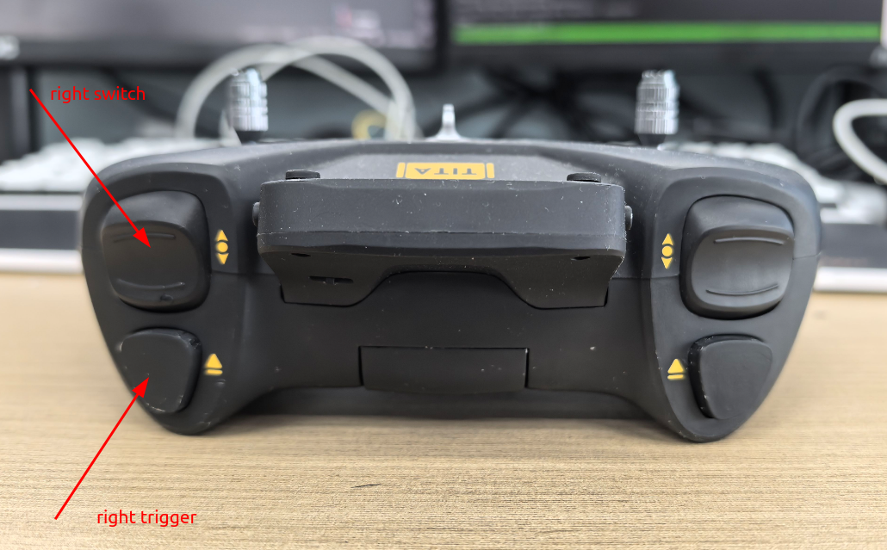
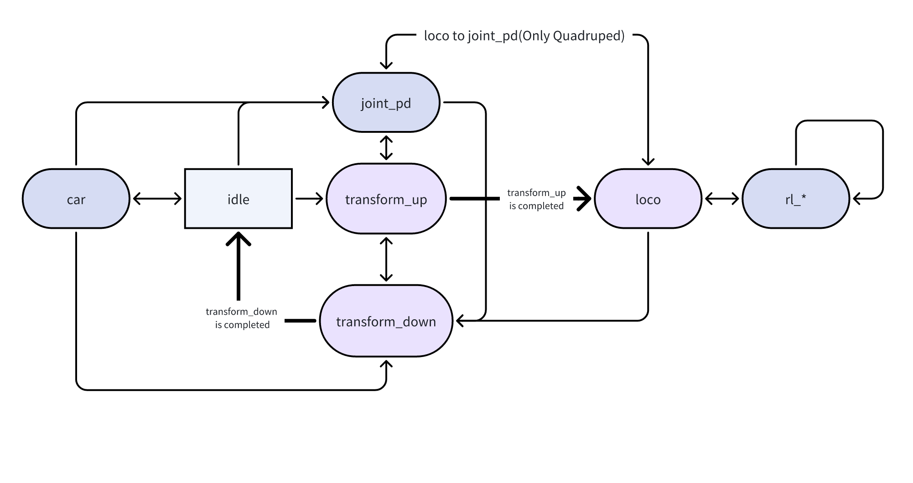
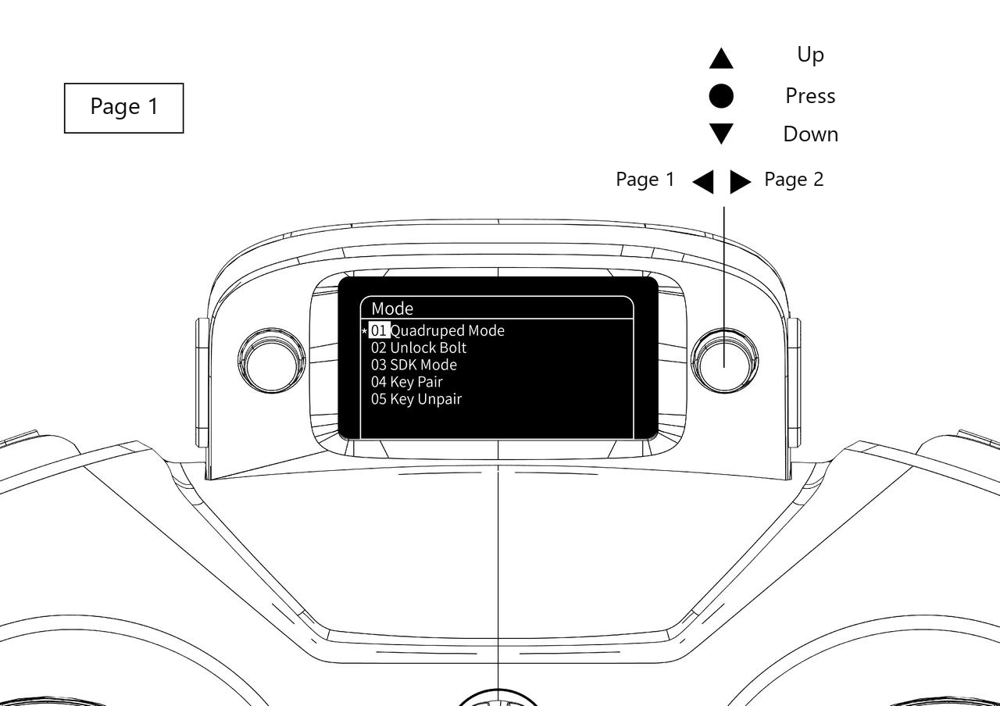
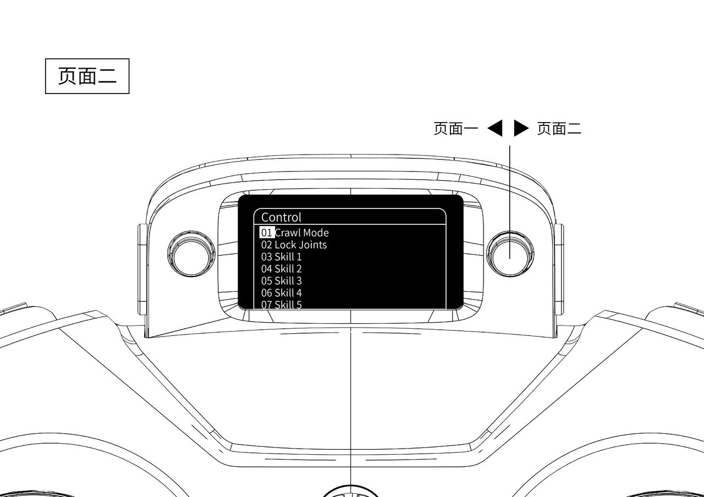
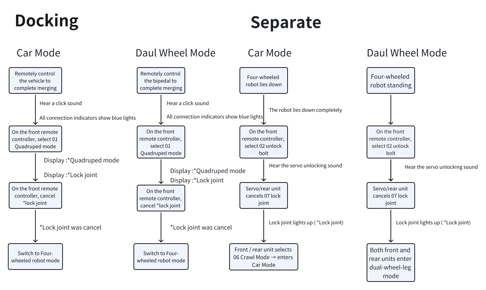
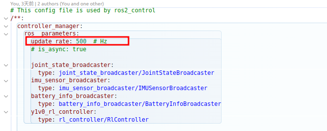
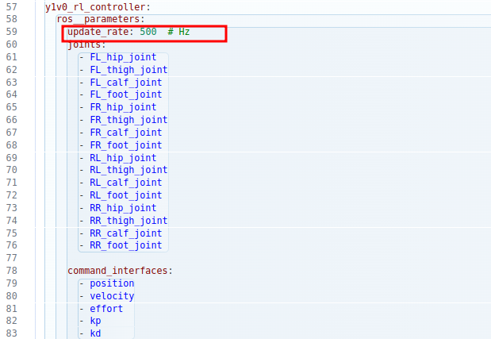

# 遥控器说明



想详细了解如何进行遥控器配对，请查看[遥控器配对](how-to-pair.md)。

## 常用组合

### 双轮足模式（默认）

| 模式选择(mode)  | 启动按键 | 三级开关(左) | 三级开关(右) | 描述         | 左摇杆     | 右摇杆             |
| --------------- | -------- | ------------ | ------------ | ------------ | ---------- | ------------------ |
| 不选            | 按下     | 中           | 任意         | 高度调节     | 前进及转弯 | 前推升高、后推降低 |
| 不选            | 按下     | 上           | 上           | 俯仰调节     | 前进及转弯 | 前推抬头、后推低头 |
| 03 (skill 1)    | 按下     | 中           | 任意         | RL平地模式   | 前进及转弯 | 侧走               |
| 04 (skill 2)    | 按下     | 中           | 任意         | RL上楼梯模式 | 前进及转弯 | 无效               |
| 06 (crawl mode) | 弹起     | 任意         | 任意         | 车模式       | 前进及转弯 | 无效               |

### 四轮足模式（默认）

| 模式选择(mode) | 跳跃按键 | 三级开关(左) | 三级开关(右) | 描述         | 左摇杆     | 右摇杆   |
| -------------- | -------- | ------------ | ------------ | ------------ | ---------- | -------- |
| 不选           | 弹起     | 中           | 任意         | RL平地模式   | 前进及转弯 | 侧走     |
| 03 (skill 1)   | 弹起     | 中           | 任意         | RL上楼模式   | 前进及转弯 | 侧走     |
| 04 (skill 2)   | 弹起     | 中           | 任意         | RL 高台模式  | 前进及转弯 | 无效     |
| 05 (skill 3)   | 弹起     | 上           | 任意         | 自由度展示   | 姿态展示   | 姿态展示 |
| 不选           | 按下     | 中           | 任意         | 向前跳跃模式 | 无效       | 无效     |

## 状态机

控制器内部状态机流转如下图所示，箭头方向表示可从 A 状态切换到 B 状态，四足控制无 car 状态机。部分在菜单内显示的状态机星号表示处于当前状态机（03 到 07）。



## 遥控器菜单页

按下右侧按键进入菜单页。通过右侧十字按钮切换页面：向右拨进入页面二，向左拨进入页面一。

### 页面一



- 01 切换四足模式（本质为上述 `*.service` 切换）
- 02 解锁拼接机构（先切换为双轮足后解锁）
- 03 joystick sdk mode，关闭 ROS 2 command 话题发布
- 04 远程开关配对
- 05 远程开关解除配对

### 页面二



- 01 匍匐模式（双轮足启用）
- 02 锁定关节
- 03 强化控制策略 1（双轮足侧走/四轮足爬楼梯）
- 04 强化控制策略 2（双轮足爬台阶/四轮足爬高台）
- 05 强化控制策略 3（双轮足未启用/四轮足展示姿态）

## 解锁/拼接切换



## 配置修改

### 遥控器

基于 ROS 2 框架，可修改对应的 YAML 文件进行配置。以下为遥控器相关配置：

```yaml
  teleop_command:
    ros__parameters:
      can_interface: vcan0
      net_interface: wlan0 
      uart_interface: /dev/ttyUSB0
      update_rate: 10 # Hz
      use_sdk: false # 默认是否启动joystick的sdk模式，默认false不启动
      enable_low_battery_check: false # 低电量，电量低机器会趴下，true为启动
      battery_percentage_threshold: 0.1 # 阈值，当电量低于此值进入到低电量状态，
      enable_joystick_disconnect_check: false # 遥控器断连检测，断连后机器会趴下，true为启动
      joystick_disconnect_time_threshold: 1.0 # 检测时间，超出此时间，遥控器断连
      joystick_deadzone: 0.013
      speed_ratio: [0.33, 0.66, 1.0]
      max_twist_linear: 3.0
      max_twist_angular: 6.0
      max_roll: 0.2
      max_pitch: 0.4
```

## 运动控制

修改控制频率时，先打开对应构型的配置文件。

**四轮足：**

```bash
vim /opt/y1_ros2/share/rl_controller/config/y1v0/controllers.yaml
```

**双轮足：**

```bash
vim /opt/y1_ros2/share/rl_controller/config/y1v0h_evt1/controllers.yaml
```

查找对应的 `update_rate` 字段，修改控制器中的整数值（控制频率，单位 Hz），目前默认为 500 Hz。修改 `controller_manager` 和 `*_rl_controller` 下的 `update_rate` 后重启即可。





## ERROR CODE


| 错误码 | 说明                                                                                                                                                                                                                                                                                                                                                                             | 版本 |
| ------ | -------------------------------------------------------------------------------------------------------------------------------------------------------------------------------------------------------------------------------------------------------------------------------------------------------------------------------------------------------------------------------- | ---- |
| 0x1000 | 第一个1代表读取错误，第二、三位代表电机错误信息（00 01 03），第四位表示错误的电机标号（0 1 ... F）。例如0x1623 :1有错误发生，62错误码，3为第四个电机例如<br>0x1000: 前机所有电机掉线，自检失败<br>0x1008: 后机所有电机掉线，自检失败<br>0x1010: 前机左腿0号电机掉线。<br>0x1033: 前机左腿3号电机（轮子）过压。<br>备注：目前只有了轮毂电机的错误信息比较丰富，关节电机只有01报错 |      |
| 0x385  | 指拼接件的can线数据异常，有可能can线未接，线材断裂                                                                                                                                                                                                                                                                                                                               |      |

### 轮毂电机错误码

轮毂电机故障码使用十六进制表示。

| 故障码 | 故障描述 |
| ------ | -------- |
| `0x00` | 无故障 |
| `0x02` | 欠压 2：母线电压 < 36 V |
| `0x01` | 欠压 1：36 V < 母线电压 < 40 V |
| `0x03` | 过压：母线电压 > 60 V |
| `0x0A` | 过流：默认母线电流 > 16 A |
| `0x20` | 过温 1：电机绕组温度 > 80 ℃ |
| `0x1F` | 过温 2：电机绕组温度 > 110 ℃ |
| `0x29` | 采样电阻故障 |
| `0x2A` | 位置传感器自身故障 |
| `0x2B` | 位置传感器信号被干扰 |
| `0x2D` | 温度传感器超出量程 |
| `0x3C` | 通信超时：默认无保护，需用户自行开启 |
| `0x62` | 堵转 |

### 关节电机错误码

以下为关节电机驱动器的故障码，使用十进制编号。遥控器目前仅显示关节电机的 `01` 报错，以下编号用于查阅驱动器故障含义。

| 故障码 | 故障 | 触发条件 | 说明 |
| ------ | ---- | -------- | ---- |
| `1` | 总线掉线 | 使能总线心跳后，在设置的时间内未接收到 CAN 指令；检测周期：1 ms | — |
| `2` | 母线过压 | 母线电压大于设置的过压值；检测周期：1 ms | — |
| `3` | 母线欠压 | 母线电压小于设置的值并持续 100 ms；检测周期：1 ms | — |
| `4` | 过流 | 电流大于设定的电流；检测周期：1 ms | 可能原因：母线电流过大、缺相、MOS 损坏或其他问题 |
| `5` | ADC 偏移量过大 | 相对于 1.65 基准的偏差大于设置的值；仅在初始化时检测 | — |
| `6` | 位置错误 | 读到的位置信号连续多次错误 | — |
| `7` | 过载 | 电流大于设置的额定电流值并持续一定时间 | 连续超过额定电流的 1.5 倍时，15 s 保护；2 倍时，5 s 保护；2.5 倍时，2 s 保护 |
| `8` | 超速 | 转速大于转速限制的 1.5 倍 | — |
| `9` | MOS 过热 | MOS 温度达到 100 ℃ | 可能原因：持续运行过热、MOS 损坏 |
| `10` | 电机过热 | 电机温度大于设置的值 | 可能原因：持续运行过热、MOS 损坏 |
| `11` | 过流 | 电流大于设定的电流；检测周期：50 μs | 三相电流不平衡 |
| `12` | 过流 | 电流大于设定的电流；检测周期：50 μs | 相电流过大 |
