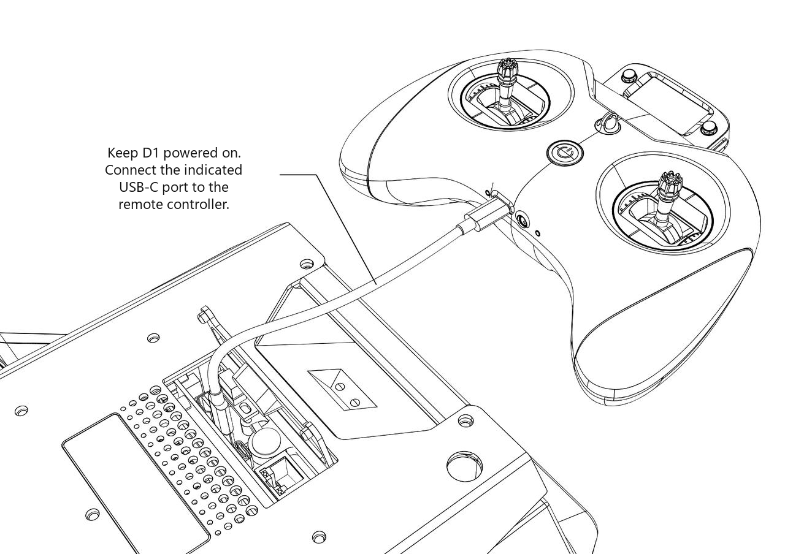
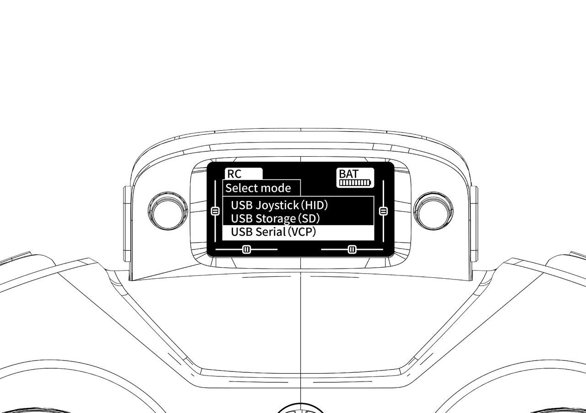
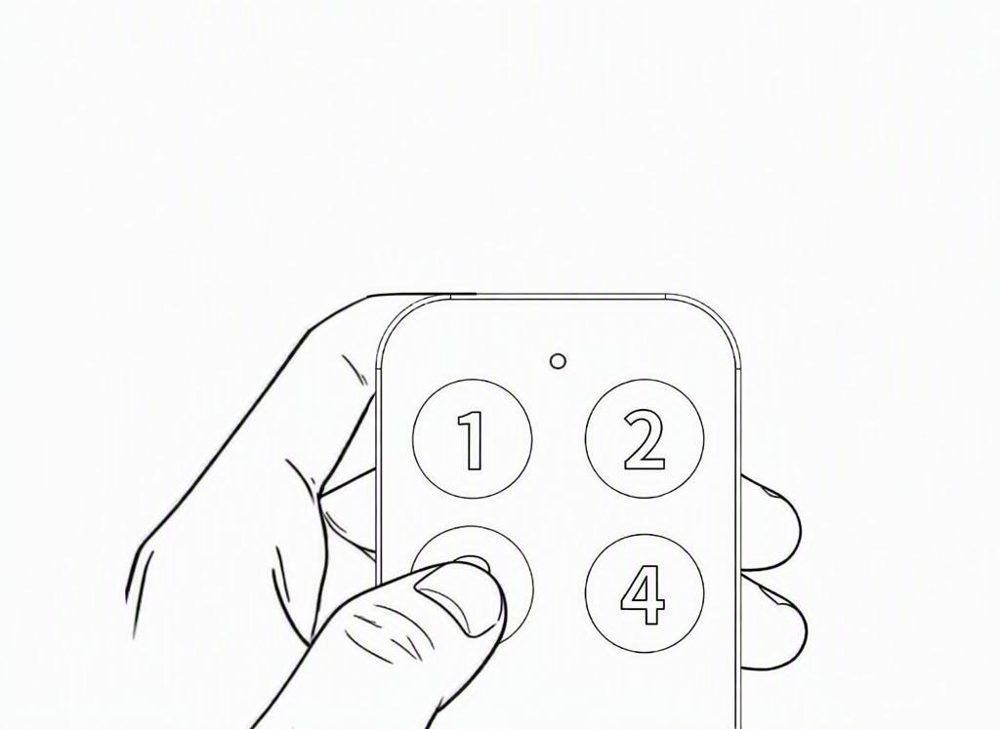

# Hardware Pairing and Connection

## Remote Controller Pairing Method 1

```{note}
For older system versions, install the pairing tool using `sudo apt install crsf-app`.
```

1. Install the pairing tool with `sudo dpkg -i crsf-app` (skip this step if it is already included or installed).

   If `crsf-app` is not installed, you can also install it with:

   ```bash
   sudo apt update
   sudo apt-get install crsf-app
   ```

2. Run the pairing command and check its output:

   ```bash
   crsf-app -bind
   ```

   

3. Power on the remote controller. Push the right-side button left to enter the menu, then select `Tools` → `ExpressLRS` → `bind` to pair with the receiver.

   

   

4. Successful pairing returns `pair success`.

   

## Remote Controller Pairing Method 2

1. Keep the robot powered on. Connect the data cable to the robot's USB-C port shown below and to the remote controller.

   

   Once connected, the remote controller displays `Select mode`. Choose the third option, `USB Serial`.

   

2. Wait until the remote controller's blue LED blinks slowly or stays on. Pairing is complete.

## Remote Emergency Stop Switch Pairing

1. Open page 1 of the robot's remote controller menu, select `04 Key Pair`, and press to confirm.

   

2. When the buzzer sounds, press button `3` on the remote emergency stop switch. You can press it repeatedly if needed.

   
